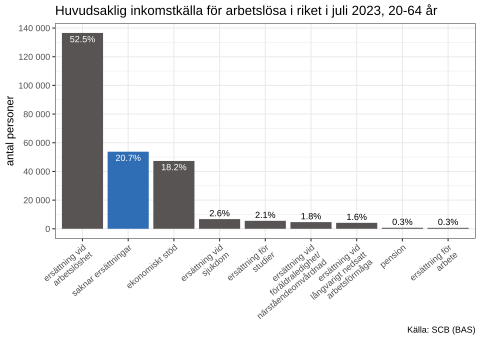

I SCB:s nya statistik över [Befolkningens arbetsmarknadsstatus (BAS)](https://www.statistikdatabasen.scb.se/pxweb/sv/ssd/START__AM__AM0210__AM0210A/ArbStatFoT1/) kan man se vad människor med olika arbetsmarknadsstatus (till exempel "sysselsatta" eller "arbetslösa") har för huvudsaklig inkomstkälla. I statistiken ser det ut som i diagrammet nedan för personer som är arbetslösa. Bara drygt hälften har sin inkomst från ersättningar för arbetslöshet. En dryg femtedel har inga inkomster alls under månaden och nästan lika många har ekonomiskt bistånd ("socialbidrag") som största inkomst.

Är det verkligen så illa eller kan det vara så att inkomststatistiken laggar efter att man blivit inskriven på Arbetsförmedlingen? Det här får jag nog reda ut med SCB.

