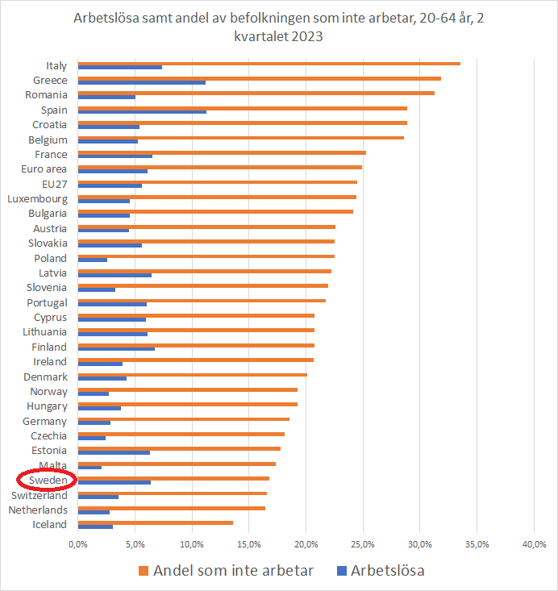

Väldigt många kan inte skilja mellan "arbetslöshet" och "människor som inte arbetar". Så här är det: För att vara arbetslös måste man dels sakna arbete och dels vara aktivt arbetssökande.

Arbetslösheten räknas som andelen människor som saknar arbete och aktivt söker arbete i procent av **arbetskraften**. Vad är då arbetskraften? Jo, det är "människor som står till arbetsmarknadens förfogande" och utgörs av dels förvärvsarbetande (sysselsatta) + arbetslösa.

När man beräknar arbetslösheten är det alltså inte hela befolkningen i förvärvsarbetande ålder nederst i bråket, utan det är arbetskraften. Men när man beräknar sysselsättningsgraden så är det antalet förvärvsarbetande dividerat med hela befolkningen i förvärvsarbetande ålder.

Det innebär att det är stora skillnader i andelen arbetslösa och andelen människor som inte förvärvsarbetar. Så här ser det ut i Europa 2 kvartalet 2023:

Sverige ligger alltså näst lägst i EU vad gäller andelen av befolkningen som inte arbetar, men har däremot en av de högsta andelarna arbetslösa. Det beror på att en väldigt hög andel av de som inte arbetar i Sverige aktivt söker arbete och därmed räknas som arbetslösa.
