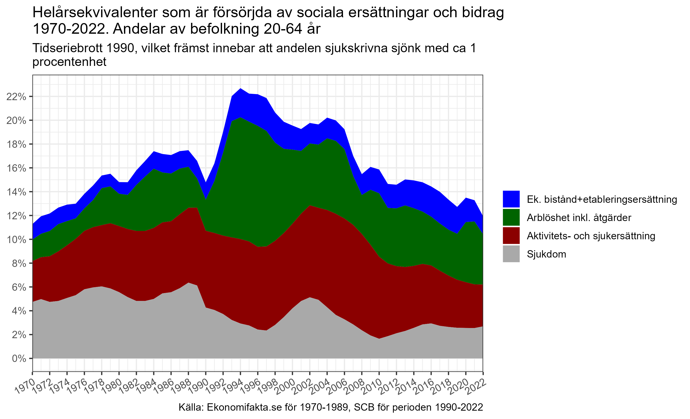

Förra året var det den lägsta andelen av befolkningen som försörjdes av sociala ersättningar och bidrag på nästan 50 år. År 2022 var det 11,9% av befolkningen mellan 20-64 år som var bidragsförsörjda.

{width="19.1cm"}

Slutsatsen har jag dragit efter att ha lagt samman den tidsserie som publicerats av Ekonomifakta för åren 1970-2005 och SCB:s tidserie för 1990-2022. Perioden 1990-2005 överlappar i bägge tidserierna och överensstämmer relativt väl så därför har jag vågat mig på att slå samman dem.

En fråga är naturligtvis om det är bra att ha så låg andel försörjda av sociala ersättningar och bidrag. Minskningen har främst skett genom en kraftig åtstramning av sjuk- och aktivitetsersättning. Det är inte orimligt att tänka sig att åtstramningen gått för långt.

Men oavsett vilket kan vi avfärda tanken på att allt blir sämre och att vi är på väg mot statsfinansiell bankrutt på grund av det exploderande antalet bidragsförsörjda.

**Källor:**

SCB:s tidsserie: <https://scb.se/hitta-statistik/statistik-efter-amne/hushallens-ekonomi/amnesovergripande-statistik/hushallens-ekonomi-allman-statistik/pong/tabell-och-diagram/helarsekvivalenter/antalet-helarsekvivalenter-19902022/>

Ekonomifaktas tidsserie 1970-2005: <https://ekonomifakta.se/Artiklar/2007/April/Manga-med-bidrag-/> SCB:s pressmeddelande:

SCB:s pressmeddelande om statistiknyheten: <https://www.scb.se/pressmeddelande/antalet-personer-med-bidrag-lagsta-sedan-matningarna-borjade/>
