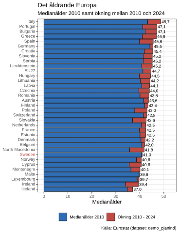
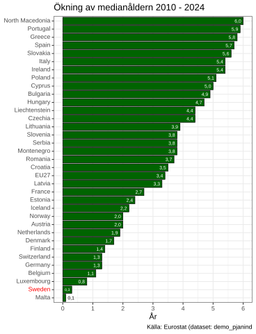
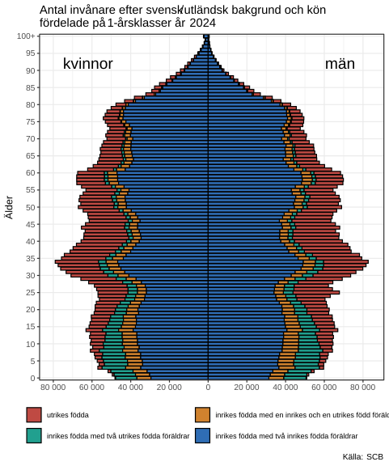

Jag tror många inte förstått hur kraftig den demografiska utmaningen är för Europa - och stora delar av övriga världen . Går vi tillbaka till 1970 hade Sverige med sin medianålder på 35,5 år den högsta medianåldern i Europa.

Hoppar vi fram till 2024 tillhör Sverige de länder som har lägst medianålder. Om vi studerar förändringen 2010 till 2024, vilket är en intressant period med stora flyktingvågor och eurokris, så kan vi dra några slutsatser.

-   Sverige är, tillsammans med Malta och Luxemburg, de enda länder som har i det närmaste oförändrad medianålder under perioden.

-   För Sveriges del beror det till stor del på stor flyktinginvandring, men i början av perioden även på relativt höga födelsetal.

-   Några länder ligger riktigt illa till. Ofta är det en kombination av utflyttning av befolkning i arbetsför ålder under eurokrisen och låga födelsetal som ligger bakom.

-   Italien ligger exceptionellt illa till. Inte nog med att medianåldern börjar närma sig 50 år, dessutom är man i bottenligan vad gäller att sysselsätta den lilla andel befolkning i förvärvsarbetande ålder som man har.

Diagrammet nedan zoomar in på ökningen av medianåldern mellan 2010-2024. På bara 14 år ökade Nordmakedonien medianåldern med 6 år, Portugal med 5,9 år och Grekland och Spanien med 5,8 respektive 5,7 år. I Sverige ökade medianåldern med 0,3 år, vilket var den näst lägsta ökningen.

Det som hållit ner ökningen av medianåldern i Sverige är till stor del invandring. Befolkningspyramiden hade sett påfallande gammal ut utan invandring. Om ambitionerna att radikalt minska invandringen får genomslag i framtidens demografi, samtidigt som födelsetalen ligger kvar på historiskt låga nivåer, står även Sverige inför stora demografiska problem.

