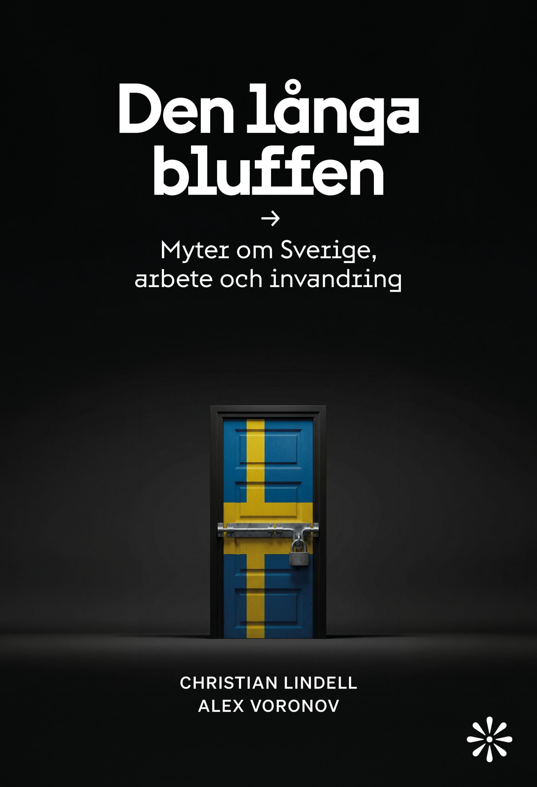

{fig-align="center" width="363"}

Nu kommer Alex Voronov och jag ut med en bok med titlen "Den långa bluffen". För mig är det en ny upplevelse att skriva en debattbok. Jag har genom åren skrivit en mängd rapporter och ett galet stort antal powerpointar. (När jag slutade mitt gamla jobb på Region Skåne så hittade jag drygt 400 pp-filer som jag producerat sedan 2010). Men en debattbok är en annan sak. Hur gick det till?

För nästan ett år sedan hörde Alex Voronov av sig till mig och föreslog att vi skulle skriva en bok tillsammans. Alex är jorurnalist och jobbar som frilans och är numera inriktad på Ukraina, men har också jobbat som liberal opinionsjournalist. Vi hade hittat varandra på Twitter och uppskattat varandras inlägg. Jag svarade ett bestämt "kanske det".

Min tveksamhet kan förklaras med att jag har en stark identitet som offentlig tjänsteman. Jag brukar undvika att lägga mig i politiska debatter eftersom jag arbetar med att serva politiker från alla läger med fakta och underlagsmaterial. Då blir det knepigt om man upplevs som politiskt profilerad. Å andra sidan känner jag ett ansvar att vara professionell och trogen fakta. Om jag utifrån mina kunskaper, uppbyggda under nästan 40 år som utredare inom arbetsmarknad och näringsliv, upplever att bilden av utvecklingen är grundläggande fel är det ansvarslöst att tiga. Om inte vi som är anställda som experter inom våra områden vågar tala, vem ska då göra det? Så efter några månaders ångerstfyllt betänketid så bestämde jag mig under stor vånda för att tacka ja.

Jag för erkänna att mitt "ja" också påverkades av att jag inte trodde att boken skulle bli av. Det saknades över 150 000 kr för att projektet skulle bli av. Jag trodde inte att vi skulle kunna få ihop den summan. Alex föreslog att vi skulle dra igång en insamlingskampanj. Bra idé, sa jag, men trodde aldrig att vi skulle kunna få ihop särskilt mycket på den. Tji fick jag. På två veckor hade kampanjen dragit in 160 000 kr! (Tack allesammans!).

Men nu är boken färdig och har skickats ut till donatorerna!

Boken kan köpas i bokhandeln eller på nätet: [Priser på Bokfynd](https://www.bokfynd.se/9789179654863 "Priser på Bokfynd")
