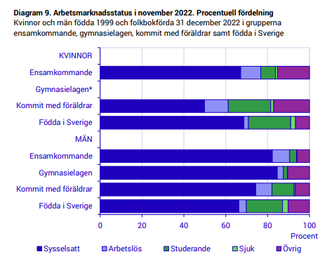
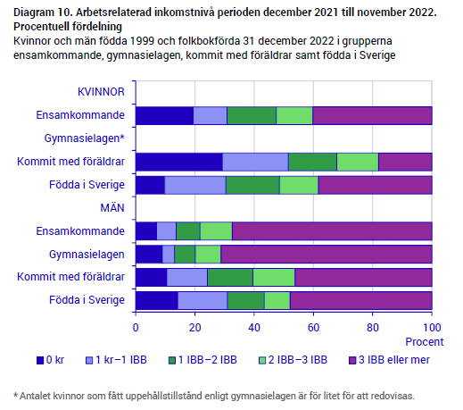
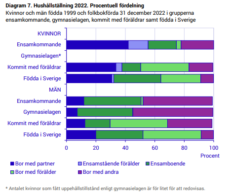
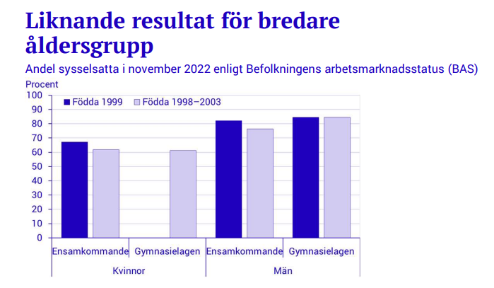
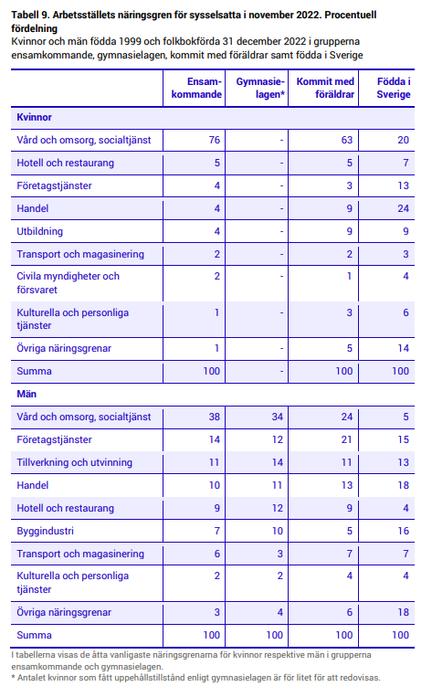

Den 28 november släppte SCB sin uppföljning av vad ensamkommande flyktingbarn som sökte asyl 2015 gjorde i november 2022. Med tanke på den enorma demonisering gruppen har utsatts för så presterade de förvånansvärt bra. Över 80 procent var förvärvsarbetande. 70 % hade en arbetsinkomst som låg över Entreprenörskapsforums gräns för "självförsörjning". Naturligtvis möttes detta av raserianfall från ytterkantshögern. Ingenting som visar att det går bra för utrikesfödda kan vara sant!

Bland annat kunde man se de här reaktionerna på X/Twitter:

Utredningen finns här: <https://www.scb.se/pressmeddelande/atta-av-tio-ensamkommande-fran-2015-ar-sysselsatta/>

## Några kommentarer till vanliga invändningar mot resultatet:

*Inte så konstigt att sysselsättningsgraden är hög. De som inte fick jobb blev ju utvisade!*

Det ligger lite grand i det, men det gäller bara de som fått stanna via gymnasielagen. Dessa utgör ca 7 000 av de totalt 20 000 som är kvar i landet. Nästan alla som stannat i Sverige är män (94%) så jag håller mig till att kommentera hur det gått för männen. Av de som fick stanna via gymnasielagen var 85% sysselsatta, av de som fått stanna som ensamkommande var 82 % sysselsatta. Hotet om utvisning för de som misslyckades med gymnasiet verkar alltså inte påverkat sysselsättningen särskilt mycket. Andelen sysselsatta för gruppen *inrikesfödda män* i hela åldersspannet 20-64 år låg i november 2022 på 86 %, så även i jämförelse med alla sysselsatta inrikesfödda positionerade sig de ensamkommande väl.

Så här ser fördelningen av de ensamkommande på olika aktiviteter ut:

{width="559"}

*Det är bara korta bidragsjobb! Det räcker att jobba 1 timme för att det ska räknas som sysselsättning!*

Det stämmer inte. I november 2022 var totalt ca 1225 utomeuropeiskt födda män mellan 20-24 år sysselsatta i arbeten som var subventionerade av Arbetsförmedlingen. Detta ska jämföras med den totala gruppen sysselsatta utomeuropeiskt födda män i samma ålder på drygt 39 900 personer. Att en stor mängd av dessa subventionerade arbeten skulle ha gått till just ensamkommande verkar helt osannolikt. Uppföljningen gjordes dessutom på bara på det vanligaste födelseåret för ensamkommande, vilket var 1999. De 1225 personerna ska alltså fördelas på fem årskullar. Därför skrev jag till Af:s utredare och bad dem plocka fram antalet män som var födda utanför Europa och var 23 år gamla 2022 och hade lönesubvention via Af. Det visade sig finnas 396 män som var födda utanför Europa och var 23 år gamla. Detta kan jämföras med att det fanns 6 500 ensamkommande män som var 23 år gamla år 2022 Maximalt kan alltså 6,1 % av de sysselsatta männen ha subventionerade arbeten tack vare arbetsmarknadspolitiska åtgärder. Men återigen - det förutsätter att samtliga dessa åtgärder gått till just ensamkommande. Snarare handlar det gissningsvis om 200-300. Vi är alltså nere på några procent av de sysselsatta som har "pysselsättning" för att tala SD-lingo.

Arbetstiden vet vi inte så mycket om, men av SCB:s undersökning framgår att över 70% hade en arbetsinkomst på MINST 3 inkomstbasbelopp (motsvarande knappt 18 000 i månaden år 2022) - jag skriver "minst" i versaler eftersom många verkar utgå från att alla dessa tjänar precis 3 inkomstbasbelopp och inte en krona mer. Den inkomsten får man inte på att jobba några enstaka timmar i veckan. Dessutom vet vi från [andra studier](https://www.scb.se/hitta-statistik/artiklar/2019/genomsnittlig-arbetstid-densamma-for-flyktingar-som-for-inrikes-fodda/) att de flyktingar som är sysselsatta arbetar lika många timmar som inrikesfödda sysselsatta. 70 procents "självförsörjningsgrad" är bättre än för inrikesfödda i samma ålder, till stor del beroende på att inrikesfödda studerar i högre utsträckning. Sysselsättningsgraden (och "självförsörjningsgraden" tenderar att stiga med vistelsetid i landet, vilket innebär att andelen "självförsörjande" sannolikt kommer att öka med stigande ålder. En relativt låg andel (runt 13 %) hade en arbetsrelaterad inkomst som låg under 2 inkomstbasbelopp (11 833 kr/månaden).

En randanmärkning är att 1-timmesgränsen för att räknas som sysselsatt inte stämmer i det här fallet. 1-timmesgränsen gäller för den enkätbaserade Arbetskraftsundersökningen (AKU), men i det här fallet är det inte den som används som källa. Källan är istället SCB:s registerbaserade BAS-statistik (Befolkningens ArbetsmarknadsStatus). I det registret räknas man som "sysselsatt" om Skattemyndigheten fått in en månatlig kontrolluppgift för utbetald lön från en arbetsgivare eller om man deklarerat inkomst som företagare. Även i denna undersökning är man alltså sysselsatt endast om man förvärvsarbetat och inte om man studerat eller haft praktik via Arbetsförmedlingen eller något liknande.

*Men de har släpat hit en massa bidragsberoende anhöriga!*

SCB tar inte upp anhöriginvandringen till de ensamkommande. Däremot redovisar man om de delar bostad med föräldrar eller inte. Det visar sig att det är en väldigt liten andel som bor tillsammans med sina föräldrar. Det är rimligt att tolka det som ett starkt indicium på att anhöriginvandringen varit liten.

{width="498"}

*Man har bara valt en enda årskull att studera! Det ligger något konstigt bakom det!*

SCB har valt den årskull där det fanns flest ensamkommande, vilket var de som var födda 1999. Men i det webbseminarium SCB höll i samband med att repporten släpptes visade man även en bild som visade hur det gått för andra årskullar. Det visade sig att det gått väldigt bra för dem också, men andelen sysselsatta var naturligtvis något lägre för de som var yngre, vilket är helt förväntat.

*Man har räknat bort alla som inte fått uppehållstillstånd! Hade man räknat med dem hade en mycket lägre andel varit sysselsatta!*

Ja, självklart har man räknat bort dem som inte fått uppehållstillstånd. Hur skulle man annars gjort? Det finns ingen undersökning där man räknar andelar på personer som inte finns i landet. Övriga som ännu inte utvisats lever i limbo utan stöd eller rätt att arbeta. Det vore högst egendomligt att räkna in dem i populationen som utvärderas.

*Det är bara en massa offentliga arbeten!*

Det är svårt att förstå varför det skulle vara sämre att de ensamkommande arbetar inom offentlig sektor än inom privat. Av vilken anledning skulle arbeten baserade på kollektiv efterfrågan vara sämre än arbeten baserade på individuell efterfrågan? Det låter väldigt mycket som ett eko från 90-talet då det pratades om "närande" och "tärande" sektorer. På vilket sätt skulle det vara mera samhällsnyttigt att de ensamkommande arbetade med att räfsa löv hos rika människor än att de jobbar inom den kroniskt underbemannade hemtjänsten med att ta hand om våra äldre?

Men alldeles bortsett från att det är ett egendomligt påstående så är det dessutom felaktigt: 38 % av de ensamkommande männen (vilka som sagt utgör nästan hela gruppen ensamkommande) arbetar inom "vård och omsorg, socialtjänst" (huvudsakligen inom äldreomsorg), medan nästan samtliga övriga arbetar inom branscher som återfinns inom privat sektor. (Dessutom är även en stor andel av äldreomsorgen privatiserad, men det är en annan fråga.)

**Så sammanfattningsvis kan vi konstatera:**

-   Nästan inga av de ensamkommande arbetar i subventionerade arbeten

-   Nästan inga arbetar få timmar

-   70 procent tjänar så mycket att de ligger över Sv Näringslivs och Entreprenörskapsforums gräns för självförsörjning

-   Väldigt få tycks ha plockat hit sin föräldrar som anhöriginvandrare

-   Ca 60 % arbetar inom branscher som återfinns inom det privata näringslivet

Visst är det konstigt att det kan väcka så mycket vrede och få folk att bli helt skogstokiga?

## Källor

Sysselsatta män mellan 20-24 år: <https://www.statistikdatabasen.scb.se/pxweb/sv/ssd/START__LE__LE0105__LE0105A/LE0105Sysselsattn01N/>

Sysselsatta utomeuropeiskt födda via anställningsstöd från Arbetsförmedlingen: <https://statistik.arbetsformedlingen.se/extensions/Manadsstatistik_sid1/Manadsstatistik_sid1.html>
