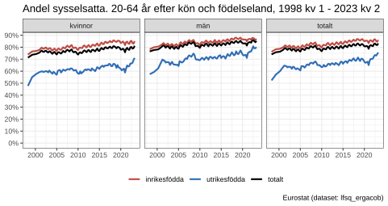
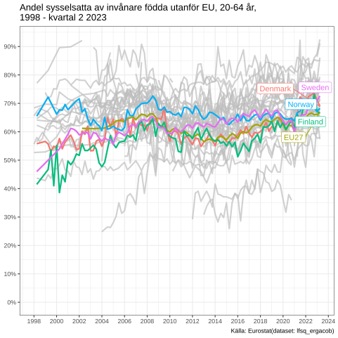
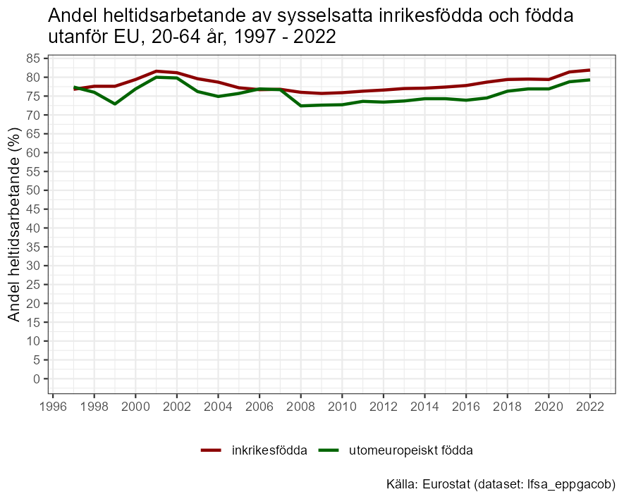
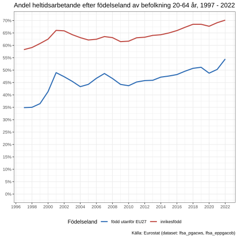
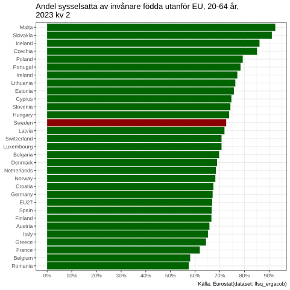

Trots att många verkar tro att integrationen på arbetsmarknaden går sämre och sämre så rusar andelen sysselsatta utrikesfödda. Framför allt är det de utrikesfödda kvinnornas sysselsättningsgrad som ökar.

[SCB har konstaterat](https://www.scb.se/hitta-statistik/temaomraden/sveriges-ekonomi/fordjupningsartiklar_Sveriges_ekonomi/fa-branscher-bidrog-till-sysselsattningstillvaxten/) att det främst är lågutbildade utrikesfödda inom servicenäringar som ökar sin sysselsättningsgrad.

Andelen sysselsatta födda utanför EU27 är stigande och var högst i Norden (undantaget Island) andra kvartalet 2023 (de grå linjerna redovisar övriga europeiska länder som finns i Eurostats databas).

Men är det en massa hittepåjobb då? Det finns massor av påståenden om att det skapas en stor mängd bidragsfinansierade 1-timmesjobb bara för att höja andelen sysselsatta utrikesfödda. Så är det inte. Det finns nästan inga skillnader i andelen heltidsarbetande inrikesfödda och de som är födda utanför EU:

Diagrammet ovan visar heltidsarbetande av de sysselsatta fördelade på födelseregion. Av diagrammet framgår att det inte finns några stora andelar deltidsarbetande av de sysselsatta som är födda utanför EU. Ca 80 procent arbetar heltid. Men hur ser det utom om man istället räknar andel *heltidsarbetande av befolkningen 20-64 år*? Då är naturligtvis andelen lägre för de som är födda utanför EU. Men även då är trenden stigande.

Hur ser det ut i ett europeiskt perspektiv? Hur stor andel av de födda utanför EU är sysselsatta i andra länder? Det ser vi i diagrammet nedan. Sverige ligger i den övre halvan av de länder som finns i Eurostats databas. De länder som ligger högre än Sverige är till stora delar länder med låg invandring från länder utanför EU27 och där merparten av invandrarna är arbetskraftsinvandrare. (För de länder som inte tillhör EU27 exkluderas inrikesfödda från de övriga som är födda utanför EU27).

Men hur är det med de bidragsfinansierade 1-timmesjobben då? Av offentlig statistik går det inte att se hur många av de som är födda utanför Europa som arbetar kort deltid (\<20 h/vecka), men vi vet av Arbetskraftsundersökningen att ca 3 procent av de utrikesfödda totalt i åldern 20-64 år arbetar mindre än 20 h / vecka. I absoluta tal motsvarar det ca 31 000 personer. Av Arbetsförmedlingens [månadsstatistik](https://statistik.arbetsformedlingen.se/extensions/Manadsstatistik_sid1/Manadsstatistik_sid1.html) vet vi också att det finns ca 30 000 sysselsatta utomeuropeiskt födda som har lönesubvention från Arbetsförmedlingen.

Av de utrikesfödda sysselsatta är ca 435 000 födda i övriga Europa och 596 000 födda utanför Europa. Om alla de 61 000 sysselsatta som är bidragsfinansierade eller arbetar kort deltid hamnade i gruppen "födda utanför Europa skulle de alltså maximalt kunna utgöra drygt 10 % av de sysselsatta. Men det är en helt orealistisk siffra. Vi vet att de sysselsatta från övriga Europa arbetar deltid i stort sett i samma utsträckning som de som är födda utanför Europa. Det vore onekligen konstigt om en väldigt stor del av de som är födda i övriga Europa arbetade lång deltid (\>= 20 h), medan nästan alla födda utanför Europa skulle arbeta kort deltid. Dessutom kan det antas att grupperna med lönesubvention och kort deltid överlappar varandra. Ca 60 procent av dem som får lönen subventionerad av Af får det på grund av nedsatt arbetsförmåga, vilket är en indikation på att en stor del sannolikt inte förmår att arbeta heltid. SCB har för övrigt granskat arbetstid för flyktingar och kommit fram till att de som är sysselsatta [arbetar lika många timmar som inrikesfödda](https://www.scb.se/hitta-statistik/artiklar/2019/genomsnittlig-arbetstid-densamma-for-flyktingar-som-for-inrikes-fodda/).

Men hur många är 1-timmesjobben då? Här saknar vi statistik över antalet sysselsatta fördelade på födelseländer. Men [senast SCB](https://www.scb.se/hitta-statistik/artiklar/2017/Vanligast-att-unga-och-aldre-jobbar-fa-timmar/) redovisade antalet sysselsatta som arbetade 1-timme under mätveckan uppgick andelen till ca 0,15%. I absoluta tal motsvarar det ca 7 900 personer av de drygt 5 230 000 som var sysselsatta i september 2023. Ska dessa fördelas på inrikes-, europeiskt och utomeuropeiskt födda så inser man snabbt att den gruppen är helt försumbar.

Vi kan alltså konstatera att:

-   1-timmesjobben är så få att de knappt syns i statistiken. De påverkar ingenting i nämnvärd utsträckning.

-   Ca 20 % av de sysselsatta arbetar deltid, oavsett om det handlar om inrikesfödda-, födda i övriga Europa eller utanför Europa. En låg andel arbetar kortare än 20 h per timmar vecka, ca 3 % av de sysselsatta, oavsett om de är inrikes- eller utrikesfödda. I absoluta antal handlar det om 31 000 utrikesfödda som arbetar kort deltid (\<20 h/vecka). Dessa ska fördelas på både de som är födda i övriga Europa och de som är födda utanför Europa. Eftersom SCB anger att flyktingar i genomsnitt arbetar lika många timmar per vecka som inrikesfödda finns det ingenting som talar för att andelen med kort deltid skulle vara markant högre bland utomeuropeiskt födda än bland övriga grupper.

-   De subventionerade jobben är många nog för att påverka sysselsättningsstatistiken tillräckligt mycket för att det inte ska vara försumbart. Bland de som är födda utanför Europa utgör dessa ca tre procentenheter av sysselsättningsgraden, medan andelen är drygt en procentenhet för inrikesfödda.

-   Slutsatsen är att den väsentliga faktorn för att mäta utomeuropeiskt föddas position på arbetsmarknaden i relation till inrikesföddas är andelen sysselsatta (sysselsättningsgraden). Bland de som är sysselsatta är det små skillnader avseende arbetade timmar och ganska små skillnader i andelen som arbetar med subventionerade arbeten (notera dock att även de med subventionerad lön utför arbete och tillför nytta till arbetsgivaren. De subventionerade arbetena bygger på att det finns en arbetsgivare som är beredd att betala en del av lönen).

Kommer det här att få tyst på debatten om 1-timmesjobben? Knappast. Det kommer alltid finnas de som påpekar att siffrorna inte säger någonting om afghanska kvinnor mellan 40-45 år i utanförskapsområden eller somalier i Botkyrka som anlänt 2021.Och det är ju sant. Läsaren får själv fundera på hur relevanta den typen av invändningar är.

Min personliga åsikt är att SCB borde bli mycket bättre på att redovisa statistik fördelad på födelseland och arbetstid. Det hade undanröjt många myter om invandrare och inrikesfödda. Men antagligen hade det bara inneburit att personer i alternativhögerns ekokammare hade ifrågasatt SCB istället - allt för att inte behöva ändra sina fördomar.

**Källor**

För Eurostatstatistiken - gå till [Eurostats databas](https://ec.europa.eu/eurostat/data/database) och sök på den datasetkod som anges i varje diagram.

För sysselsatta per födelsregion (kontinent): <https://www.statistikdatabasen.scb.se/pxweb/sv/ssd/START__LE__LE0105__LE0105A/LE0105Sysselsattn01N/>

För sysselsatta subventionerade av Arbetsförmedlingen: <https://lindellch.quarto.pub/statistik-och-strunt/posts/vad_ar_sysselsattning/>
