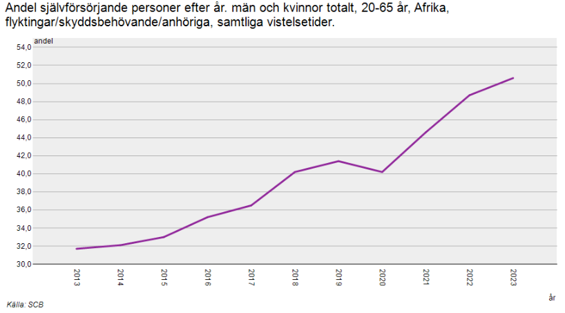
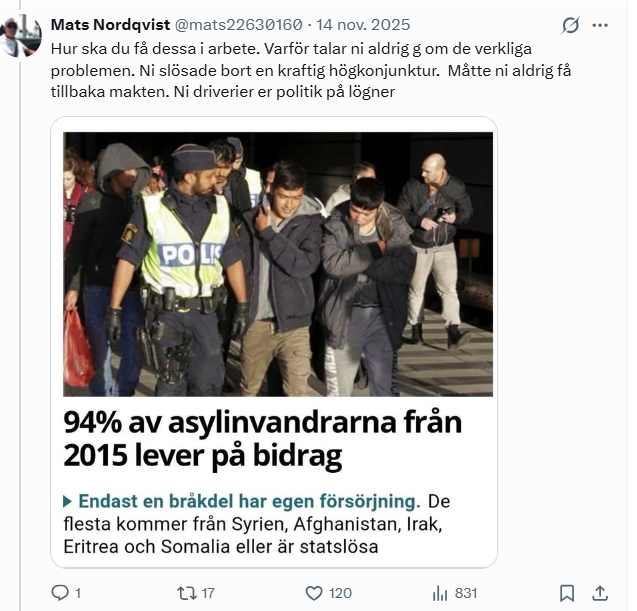
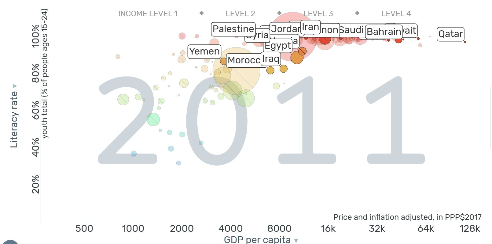
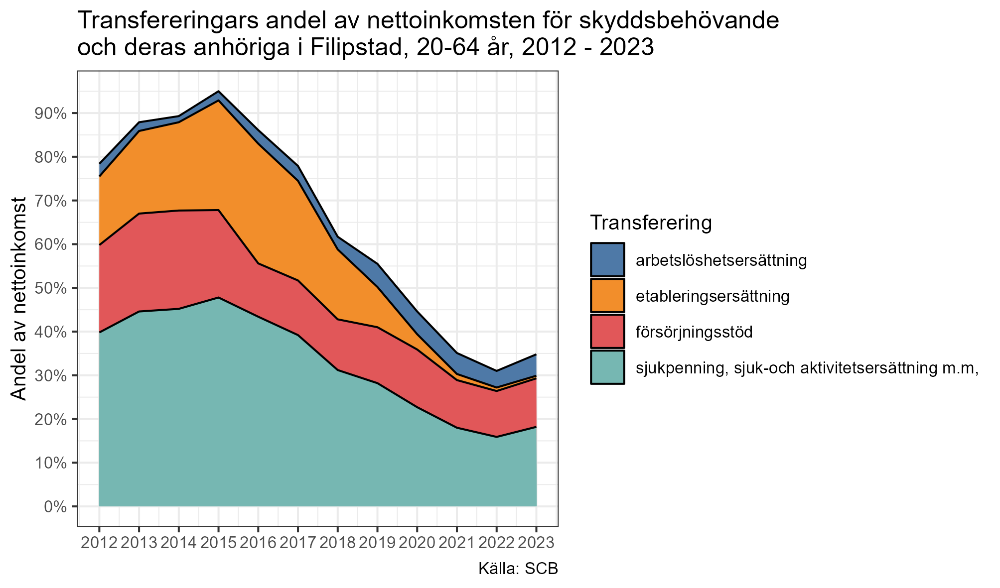

Om man är inne på X möts man ständigt av några återkommande hänvisningar till artiklar. De handlar om somalier, om hur uselt flyktingar från 2015 är integrerade och om hur hemskt de är i Filipstad efter det stora flyktingmottagandet. Det de har gemensam är att de alla bygger på föråldrade fakta som sedan länge passerat bäst-före-datum, men ändå fortsätter att publiceras om och om igen.

## Nästan inga somalier arbetar

Låt oss börja med somalierna. Det här inlägget har jag sett ett stort antal gånger i olika varianter. : 

Enligt den länkade artikel är endast 21 procent av somalierna mellan 16-64 år sysselsatta! Vad man missar är att Arbetet-artikeln är från 2015 och statistiken som refereras är från 2010. Enligt en senare publicerad [rapport](https://theglobalvillage.se/wp-content/uploads/2021/06/Uppdaterat-Rapport-Fakta-for-forandring_svensksomalierna_uppslag_lowres.pdf) med statistik från 2018 var 48 procent sysselsatta (åldern 20-64 år) vilket var en uppgång med nästan 20 procentenheter sedan 2013. Fortfarande en låg andel förvärvsarbetande, men en väldigt kraftig ökning på bara fem år. Tyvärr har jag inga uppgifter om sysselsättningsgrad för somalier som är senare än 2018 men med tanke på ökningen av "självförsörjningsgraden" för flyktingar från Afrika sedan 2018 så finns det starka skäl att tro att andelen sysselsatta ökat ytterligare (notera bruten axel).

## Den usla integrationen av flyktingar från 2015

Den här artikeln dyker upp då och då. Alltid som en skärmdump vilket innebär att den är svår att kolla upp:

Skärmdumpen kommer från Samnytt och refererar till en artikel i Aftonbladet. Det man missar är att artikeln är från 2019 och att uppföljningen baseras på hur många som var sysselsatta i november 2017. Med tanke på att de stora flyktingvågen skedde under hösten/vintern 2015 så är det alltså en uppföljning som baseras på att de flesta varit i Sverige runt 2 år. Hur i all världen är det relevant år 2025? (Om vi går till den senast tillgångliga statistiken så kan vi se att dem som kommunplacerades 2016 var 65 procent förvärvsarbetande år 2023.). Men det låter ju bättre att 94 procent lever på bidrag.

## Det bottenlösa eländet med analfabetflyktingar

Den här skärmdumpen återkommer också ständigt.

Ofta presenteras det som att det är ett officiellt uttalande från Arbetsförmedlingen, men det är i själva verket en lokalanställd strateg som uttalar sig om läget i Filipstad. Påståendet är i sig dessutom felaktigt. Med undantag av flyktingar från några länder där statsapparaten kollapsat, så är läskunnigheten bland unga relativt hög även i våra större flyktingländer. Oftast ligger läskunnigheten på 85+ procent (statistik från Gapminder).

Varför skulle läskunniga plötsligt bli analfabeter bara för att de flyr? Ibland hänvisas till OECD:s PIAAC-undersökning, men den mäter inte analfabetism utan läsförståelse på *svenska*. Att ha låg läsförståelse på ett specifikt språk är inte samma sak som analfabetism. Jämför vi dessutom resultaten från PIAAC 2012 med undersökningen från 2023 framgår att antalet invånare med låg läsförståelse är i det närmaste oförändrat, trots det stora flyktingmottagandet fram till och med 2015. Man kan alltså anta att utrikesfödda som hade otillräcklig läsförståelse 2012 har förbättrat sina resultat och att det är mera nyanlända utrikesfödda som har otillräcklig läsförståelse 2023. Integrationen fungerar alltså.

För Filipstads del så gick det inte heller så dåligt. Även där ökade sysselsättningen för utrikesfödda snabbt och andelen flyktingar som försörjdes av transfereringar sjönk snabbt:

Visserligen ökade kostnaderna för ekonomiskt bistånd kraftigt för kommunen, men skatteutjämningssystemet kompenserade mer än väl för den ökade kostnaden. Tittar man på kommunens ekonomi så kan man se att den påverkats betydligt mera av de senaste årens inflation och växande pensionsskuld än av flyktingmottagande.

## Var kommer allt ifrån?

De tre exemplen jag visat återkommer gång på gång. Ibland nämns bara siffror utan hänvisning - "bara en femtedel av somalierna arbetar", "94 % av flyktingarna lever på bidrag" - men det går lätt att se var de hämtats ifrån. Det är inte utan att man kommer att tänka på militära mobiliseringsförråd fyllda med spruckna gummidäck, jästa konservburkar och chokladkakor som det gått mask i. Finns det ett mob.förråd för kulturkrigare med artiklar som sedan länge passerat bäst-före-datum?
