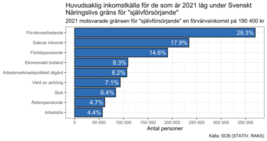
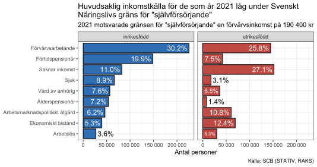
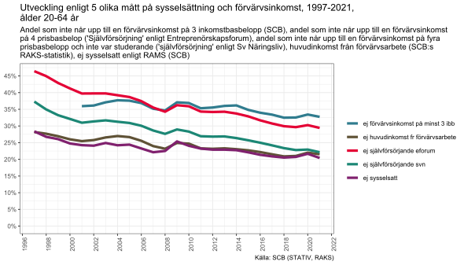
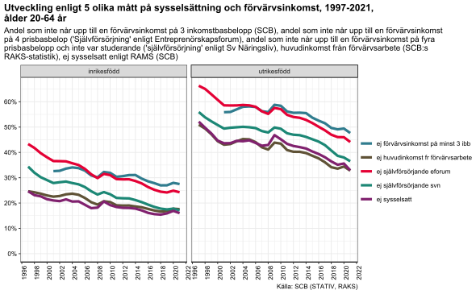
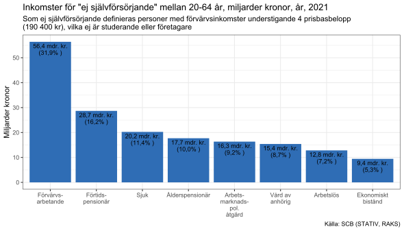
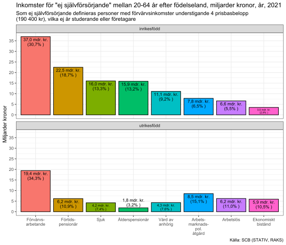

***En sak som förvånar mig med debatten runt "självförsörjning" är ointresset för hur de "ej självförsörjande" faktiskt försörjer sig. Det borde vara av avgörande betydelse för att kunna föreslå effektiva strategier för att öka "självförsörjningen". Min avsikt med det här inlägget är att i alla fall delvis täppa igen den kunskapsluckan. Det visar sig att det finns många olika skäl till att individer inte är självförsörjande. Även de med låga inkomster har i stor utsträckning förvärvsarbete som största inkomstkälla. Andra har inga inkomster alls, vare sig från arbete eller sociala ersättningar och bidrag. Mindre än fem procent av de ej "självförsörjande" har sin huvudsakliga inkomst från ekonomiskt bistånd.***

## Självförsörjning är ett trubbigt och politiskt begrepp

När man diskuterar "självförsörjning" är det viktigt att ha några saker i minnet:

-   *De mått på "självförsörjning" som cirkulerar i debatten mäter inte (egendomligt nog givet namnet) självförsörjning.* De är inkomstgränser som satts mer eller mindre godtyckligt. Entreprenörskapsforum har satt en inkomstgräns på fyra prisbasbelopp (motsvarande en inkomst på 190 400 kr år 2021) och kommer fram till att det finns 1,8 miljoner "ej självförsörjande" mellan 20-64 år. Svenskt Näringsliv använder samma inkomstgräns, men räknar även bort en halv miljon studerande från de ej "självförsörjande" och landar därmed på att det finns 1,3 miljoner invånare som inte försörjer sig själva.

-   *Varför gäller självförsörjningsmåttet endast sociala ersättningar och bidrag?* Om man menar allvar med att varje invånare ska täcka sina egna kostnader, varför ingår inte kostnader för utbildning, kultur, infrastruktur m.m.? Ett skäl är att det skulle visa att en stor del av befolkningen är "olönsam" i detta snäva perspektiv. Samtidigt skulle samhället kollapsa om vi tog bort alla handelsanställda, busschaufförer, vårdbiträden och alla andra lågavlönade som inte" täcker sina egna kostnader". I detta perspektiv är det till exempel tveksamt om kvinnor som grupp är lönsamma för samhället.

-   *"Självförsörjning" mäts på individnivå. Men den minsta ekonomiska enheten är hushållet.* Även om en person har låga eller inga inkomster kan det finnas en mera välsituerad partner. Om ena partner går ner i arbetstid under småbarnsåren eller studerar och därmed får låga förvärvsinkomster är det inte nödvändigtvis ett samhällsproblem och innebär inte att det krävs några insatser från samhället.

-   *Självförsörjning är ett politiskt begrepp*. Det kan tyckas självklart att alla ska vara självförsörjande. Men det är inte så det är tänkt i ett modernt välfärdssamhälle. En grundläggande funktion i välfärdsstaten är omfördelning mellan generationer och mellan fattiga och rika. Om vi tycker att det är eftersträvansvärt att utjämna ojämlikhet så kommer det alltid att finnas de som betalar mer än de får ut från det offentliga. Det är ingen bugg i systemet, det är så det är tänkt att fungera. Har man den grundinställningen blir det istället intressant att fundera på *varför* omfördelningen behövs. Att människor får bidrag eller sociala ersättningar på grund av att de saknar arbete bör naturligtvis åtgärdas (hur beror på politisk läggning och syn på vad som påverkar arbetsmarknaden). Men om människor får bidrag på grund av sjukdom kräver det helt andra insatser och är kanske bara marginellt påverkbart.

-   *Ord spelar roll. Om man talar om "självförsörjning" tolkas bristen på inkomster som ett individuellt problem.* Om man istället använder termer som "låginkomsttagare" eller "fattiga" går tankarna snarare till att det är ett samhälleligt problem. Man kan se att "självförsörjning" är ett politiskt begrepp genom att termen har anammats huvudsakligen av aktörer på den högra sidan av det politiska fältet (Timbro, Bulletin, Kvartal, Svenskt Näringsliv m.fl).

-   *Sociala bidrag och ersättningar har olika funktioner.* I vissa fall är det eftersträvansvärt att invånarna lever på bidrag och ersättningar: Vi vill att människor ska studera och kompetensutveckla sig och staten eftersträvar att människor ska ta ut föräldraförsäkring. Men att människor är sjuka och blir förtidspensionerade eller är arbetslösa är naturligtvis negativt för både individen och samhället.

-   *Statistiken är svårtolkad. Att människor har låga inkomster ett år kan bero på att de är på väg in- eller ut ur arbetslivet och bara haft en inkomst under delar av året.* Det är även stor skillnad på om en individ har låga inkomster på grund av att denne helt saknar arbete eller om de låga inkomsterna beror låga löner eller deltidsarbete. I det senare fallet kan man välja att tolka det som att de bör erbjudas heltidsarbete eller att lönerna borde höjas.

## Tillbaka till ursprungsfrågan. Hur försörjer sig de ej "självförsörjande"?

I redovisningen nedan har jag valt att använda mig av Svenskt Näringslivs mått på ej "självförsörjande", dvs individer mellan 20-64 år med en förvärvsinkomst under 4 prisbasbelopp och som inte är studerande. Jag har använt SCB:s RAKS-statistik för att fördela dem på vilken huvudinkomst de hade år 2021. RAKS täcker nästan alla större inkomstkällor med tre undantag: Kapitalinkomster, barnbidrag och bostadsbidrag.

Som framgår av diagrammet nedan var det 28 procent av de ej "självförsörjande" som fick sin största enskilda inkomst från förvärvsarbete.

Den näst vanligaste "inkomstkällan" var de som "Saknar inkomst". Av de 1,3 miljonerna var det 18 procent (ca 230 000 personer) som helt saknade alla inkomster, alltså inte bara förvärvsinkomster utan verkligen alla inkomster, inklusive sociala ersättningar och bidrag. Den här gruppen är heterogen. Den rymmer hemmafruar, en del utslagna, backpackers som reser runt i världen ett år, personer som jobbar inom turismindustrin i länder som Egypten och Thailand (det är nästan hopplöst att få arbetstillstånd. Nästan alla arbetar svart och får inkomster som inte syns någonstans). Men framför allt rymmer gruppen en stor mängd utrikesfödda som emigrerat, men underlåtit att rapportera in det till Skatteverket. Det finns lite olika skattningar av hur stor övertäckningen är i folkbokföringen. Skatteverket anger att det kan handla om 70 000 personer, men jag har även hört att det kan handla uppemot 100 000 personer. Det är inget ekonomiskt problem eftersom de inte får några som helst ersättningar, men det ställer till en del problem i statistiken.

Nästa stora grupp är personer med sjuk- och aktivitetsersättning (vilka kallas för "förtidspensionärer" i RAKS-statistiken). Det här är personer som av olika skäl (främst hälsoskäl) bedömts inte kunna få ett arbete.

På fjärde plats kommer ekonomiskt bistånd ("socialbidrag"). 8 procent av de ej "självförsörjande" har ekonomiskt bistånd som sin huvudsakliga årsinkomst, vilket motsvarar drygt 100 000 individer.

På femte plats kommer de som får sin största ersättning från aktivitetsstöd eftersom de deltar i en arbetsmarknadspolitisk åtgärd. Även de är drygt 100 000 personer.

Sedan kommer "vård av anhörig". Det handlar främst om föräldraförsäkring, dvs föräldralediga. Det är inte ett helt väl valt namn. Åtminstone mina tankar går snarare till att det handlar om människor som tar hand om sina gamla föräldrar, men så är inte fallet.

På sjunde plats kommer ersättningar för sjukdom (sjukpenning). Tillsammans med förtidspensionerade är det alltså ungefär en femtedel av alla ej självförsörjande som har sin huvudsakliga inkomst från ersättningar kopplade till ohälsa.

På näst sista plats kommer tidiga ålderspensionärer som gått i pension innan de fyllt 65 år. Allra sist kommer de som har ersättningar för arbetslöshet som sin huvudinkomst. Det handlar om drygt 4 procent av de ej "självförsörjande". Det kan tyckas lågt men den låga andelen beror på att de allra flesta arbetslösa får jobb på relativt kort tid eller börjar studera och därmed aldrig får a-kassa som sin största inkomst under året.

Sammanfattningsvis kan vi se att det finns en mångfald olika sätt att försörja sig om man ligger under gränsen för "självförsörjning". Relativ få av de ej "självförsörjande" står till arbetsmarknadens förfogande förutom de som redan arbetar. En stor grupp saknar helt alla inkomster, vilket ofta beror på att de inte finns i landet. Andra lider av ohälsa och är sjukskrivna eller förtidspensionerade.

## Skillnader i inkomstkällor för inrikes- och utrikesfödda ej "självförsörjande"

Av de ca 1,3 miljonerna ej "självförsörjande" var det 561 000 som var utrikesfödda (43 %) och 746 000 som var inrikesfödda (57 %). Hur ser det ut om vi fördelar huvudinkomsterna på inkomstkälla och in- och utrikesfödda? Det framgår av diagrammet nedan. Av de utrikesfödda är det hela 27 procent som helt saknar inkomster (ca 152 000 personer). Här finns med stor sannolikhet en stor grupp som emigrerat, men fortfarande finns kvar i folkbokföringen.

## Andelen ej "självförsörjande" är sjunkande

Andelen ej "självförsörjande" är kraftigt sjunkande över tid, vilket framgår av nedanstående diagram. Oavsett vilket mått vi väljer minskar andelen som i någon mening saknar eller endast har låga förvärvsinkomster eller saknar arbete.

Delar vi upp den utvecklingen på in- och utrikesfödda blir den nedåtgående trenden ännu tydligare:

Jag har skrivit mer om ämnet i det [här](https://lindellch.quarto.pub/statistik-och-strunt/posts/matt_5/) inlägget.

## Show me the money!

Men vad handlar det om i pengar? Diagrammet nedan visar hur mycket de olika inkomstkällorna i RAKS står för av de ej "självförsörjandes" inkomster. Den största enskilda inkomstkällan kommer från förvärvsarbete. Notera att endast 5 procent av inkomsterna kom från ekonomiskt bistånd. (Det är knappaste så det framstår i den offentliga debatten!) Inkomstfördelningen förstärker bilden av hur mångfacetterad försörjningen för låginkomsttagare är. Det finns många olika skäl till låga inkomster. De inkomster som inte har att göra med förvärvsarbete, ohälsa, föräldraledighet eller ålderspension står för en förhållandevis låg andel av inkomsterna till de ej "självförsörjande". Summeras ersättningarna för arbetsmarknadspolitiska åtgärder, arbetslöshet och ekonomiskt bistånd uppgår de totalt 38 miljarder kronor. Det är naturligtvis ett enormt belopp, men det utgör ändå bara 21 procent av inkomsterna för de ej "självförsörjande". De som "står till arbetsmarknadens förfogande" och får alltså en ganska liten del av ersättningar och bidrag. Majoriteten av ersättningarna och bidragen går till "förtidspensionärer" (med sjuk- och aktivitetsersättning), arbetslösa, föräldralediga och ålderspensionärer.

Men hur ser det ut om vi fördelar inkomsterna för de ej "självförsörjande" på in- och utrikesfödda? Då får vi det här resultatet:

De utrikesfödda "ej självförsörjande" som kan tänkas stå till arbetsmarknadens förfogande (de i arbetsmarknadspolitiska åtgärder, arbetslösa och de med ekonomiskt bistånd) får drygt 20 miljarder i ersättningar och bidrag. Siffrorna baseras på Sv Näringslivs definition av "ej självförsörjande", vilket innebär att studenterna är borträknade. Då landar man på 560 000 utrikesfödda ej "självförsörjande". Av dessa har 27 % inga inkomster alls, sannolikt ganska ofta beroende på att de emigrerat utan att det registrerats i folkbokföringen. Återstår alltså drygt 400 000 som uppvisade någon ekonomisk aktivitet överhuvudtaget.
