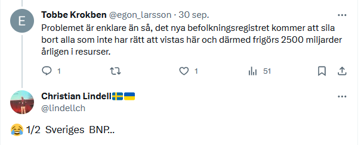
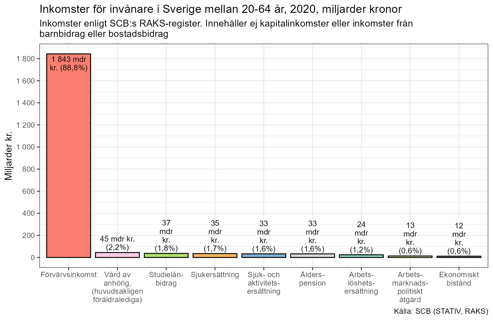

Jag slås ofta av att människors förmåga att bedöma storheter är ganska begränsad när de lämnar sitt kompetensområde. Ett exempel är en konversation på Twitter jag hade nyligen om kostnaden för papperslösa:

För mig var det uppenbart knäppt att påstå att ett antal tusen papperslösa skulle kosta halva Sveriges BNP, men för "Tobbe Krokben" var det uppenbarligen rimlig.

En annan fråga där folk generellt sett har svårt att uppskatta storheter är när det gäller sociala ersättningar och bidrag. Visst är 12 miljarder kronor mycket, Det är vad kommunerna betalade ut i ekonomiskt bistånd år 2020. Men vad är det i proportion till de samlade inkomsterna? Diagrammet nedan visar vad befolkningen mellan 20-64 år har för inkomster. Statistiken är hämtat från SCB:s Regiserbaserade aktivitetsstatistik (RAKS). Hur mycket är då 12 miljarder kronor? Det motsvarar 0,6 % av de samlade inkomsterna. I debatten läggs alltså väldigt mycket krut på en ganska lite post. Nästan 90 procent av våra inkomster kommer från förvärvsarbete. (Notera att RAKS inte innehåller inkomster från kapital, bostadsbidrag eller barnbidrag.). Det är svårt att hävda att vi håller på att gå under av bidrag och ersättningar, framför allt inte eftersom andelen personer som försörjer sig på sociala ersättningar och bidrag inte varit så låg som nu på nästan [50 år.](https://lindellch.quarto.pub/statistik-och-strunt/posts/bidrag/)

