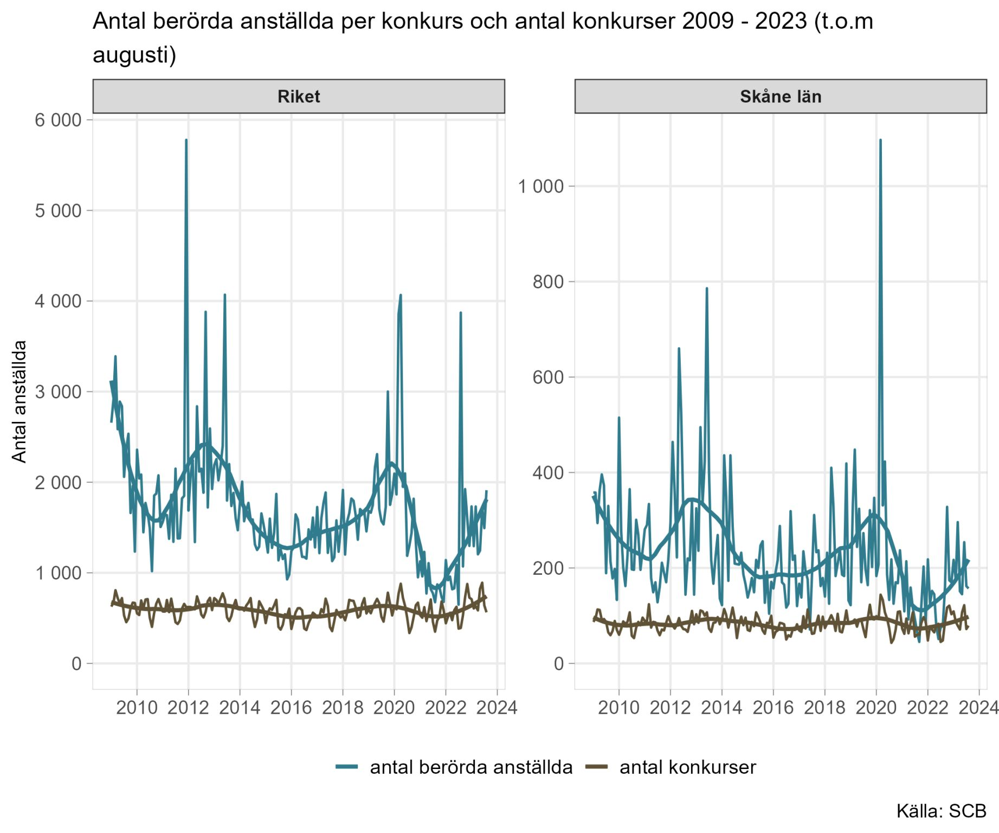
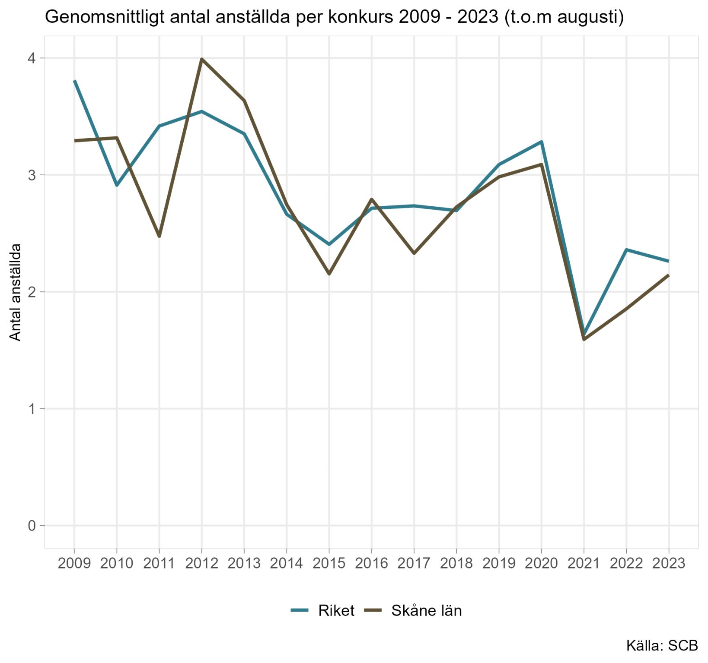

Det skrivs en hel del om de ökande konkurserna i massmedia. Men jag är lite misstänksam mot sådan statistik. Det är nästan alltid de stora kommersiella företagsregistren som ligger bakom och det är nästan alltid alarmistiska påståenden. Konkursstatistiken blir ett sätt att marknadsföra bolagen och skapa mediautrymme

Det stämmer att antalet konkurser stiger brant, vilket framgår av diagrammet nedan.

Samtidigt är det nästan bara väldigt små företag som går i konkurs. Antalet berörda anställda per konkurs har sjunkit från nästan 4 under finanskrisen 2008/09 till drygt 2.

Man får också vara försiktig med att göra jämförelser under korta perioder. Antalet konkurser per månad kan hoppa väldigt mycket och det finns stora säsongsvariationer (framför allt tenderar antalet konkurser sjunka under sommaren). För att underlätta läsningen av diagrammet med de spretiga månadssiffrorna har jag lagt på en trendlinje.

Ökningarna av konkurserna är definitiv ett teckan bland flera på att konjunkturen viker nedåt. Men många tycks tro att konkurserna i sig är en stor källa till arbetslöshet och sviktande ekonomi. Så är det inte.
