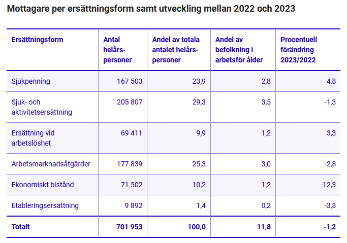
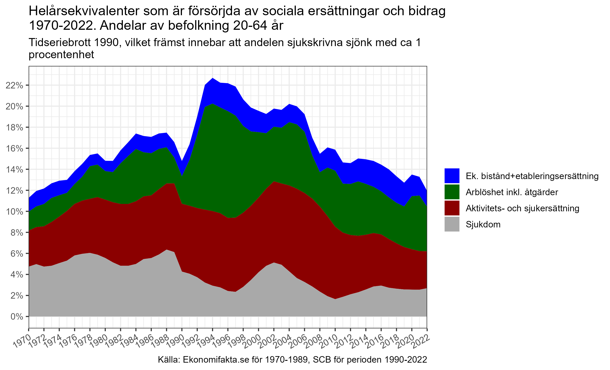

***Då och då dyker uppgiften om att "utanförskapet" kostar 270 miljarder kronor om året. Men var kommer den siffran ifrån? Och vad menas med kostnad i sammanhanget?***

Uppgiften kommer från en [undersökning](https://www.svensktnaringsliv.se/bilder_och_dokument/3ty0xo_utanforskapets-kostnaderpdf_1170079.html/Utanfo%25CC%2588rskapets+kostnader.pdf) som Svenskt Näringsliv låtit SCB göra. Den utgår från att 800 000 helårsekvivalenter lever på sociala ersättningar och bidrag. Siffran 800 000 baseras på SCB:s undersökning om ersättningar från [sociala ersättningar och bidrag](https://www.scb.se/pressmeddelande/rekordfa-personer-med-sociala-ersattningar-och-bidrag/) som publiceras i mars varje år sedan 1990. Numera är det ca 700 000 personer, men Svenskt Näringsliv valde pandemiåret 2020 som mätår och då var siffran ca 800 000. Vad menas då med "sociala ersättningar och bidrag"? SCB delar in dessa i 6 olika kategorier som framgår av tabellen nedan (Källa: [SCB](https://www.scb.se/hitta-statistik/statistik-efter-amne/hushallens-ekonomi/amnesovergripande-statistik/hushallens-ekonomi-allman-statistik/pong/statistiknyhet/antal-personer-forsorjda-med-sociala-ersattningar-och-bidrag-2023/)):

Enligt SCB:s registerbaserade aktivitetsstatistik (RAKS) för 2020 uppgick den totala kostnaden för de ersättningsformer som SCB redovisar till ca [117 miljarder kronor](https://lindellch.quarto.pub/statistik-och-strunt/posts/inkomster/) år 2020. Men hur kan 117 miljarder kronor förvandlas till en kostnad på 270 miljarder? Det beror på hur Svenskt Näringsliv beräknat kostnaden: "FASIT har använts för att beräkna hur mycket en genomsnittlig person som är fullt sysselsatt (mer än 90 procent) bidrar med till offentlig sektor jämfört med en person inte är sysselsatt." **Skillnaden mellan faktiskt inbetalad skatt och genomsnittlig skatt från en heltidssysselsatt räknas alltså en kostnad(!).** Man ska även tänka på att av 117 miljarder kronorna räknas nästan hela summan som beskattningsbar inkomst, vilket innebär att nettokostnaden för statskassan är mindre.

I mina ögon blir det väldigt konstigt att räkna en mindre inkomst än från en genomsnittlig skattebetalare som en kostnad. Av kostnaden på 270 miljarder står alltså mindre intäkter till statskassan än från en genomsnittlig heltidsarbetande för 153 miljarder kronor!

Ett annan fråga är vad man ska ha beräkningen till? Som vanligt redovisar inte Svenskt Näringsliv vad personerna som befinner sig i "utanförskap" faktiskt försörjer sig på, vilket gör undersökningen oanvändbar som underlag för insatser. Som framgår av SCB:s redovisning så är den största anledningen till att personer inte arbetar att de drabbats av ohälsa. Av de 700 000 som levde på sociala ersättningar och bidrag var det mer än hälften som uppbar ersättningar på grund av ohälsa. Den näst största gruppen består av arbetslösa (personer som försörjs av a-kassa och aktivitetsstöd) och därtill kommer en relativt liten grupp som försörjs av ekonomiskt bistånd ("socialbidrag") och etableringsersättning från kommunen. Naturligtvis kan man sträva efter att minska arbetslösheten, men man måste vara medveten om att Sverige har en mycket låg andel av befolkningen som inte arbetar, både jämfört med andra EU-länder och med oss själva över tid. Vi får gå tillbaka till slutet av 80-talet för att hitta en lika hög andel förvärvsarbetande av befolkningen i förvärvsarbetande ålder som vi hade 2023. Med tanke på hur få det är som lever på ekonomiskt bistånd (72 000 helårsekvivalenter) är det egendomligt hur stort fokus som läggs på den gruppen.

Med tanke på hur stort fokus Svenskt Näringsliv lagt på att bygga upp [kampanjsajter](https://www.svensktnaringsliv.se/utanforskap/) för att visa hur enormt stort "utanförskapet" är så kan man ju tro att det är ett kraftigt växande problem. Men sanningen är att andelen av befolkningen som försörjs av sociala ersättningar och bidrag inte varit [så låg som den är nu på 50 år](https://lindellch.quarto.pub/statistik-och-strunt/posts/bidrag/)! Man får gå tillbaka till första halvan av 70-talet för att hitta en lika låg andel "bidragsförsörjda":

