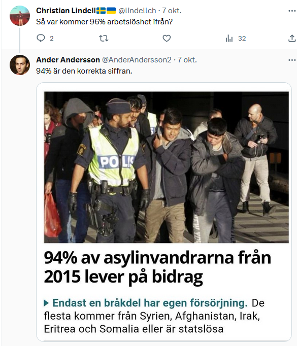
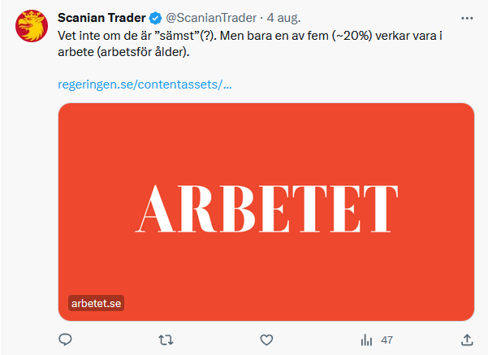
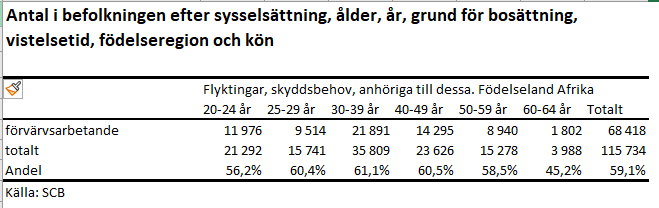
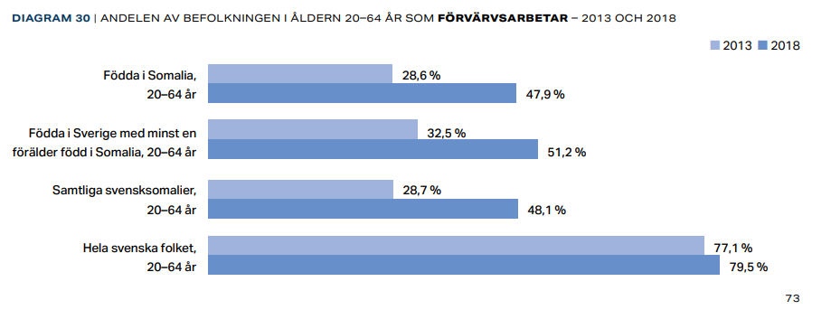

Sociala medier har blivit en lekstuga för personer som gör allt för att öka motsättningar och spänningar i samhället. Konton som oftast är anonyma med många siffror i namnet, eller har generiska namn som inte går att spåra, sprider uppgifter som det här:

Det sämsta man kan göra är att börja argumentera med utgångspunkt från den länkade artikeln. Man kan se folk som invänder genom att skriva att det är en diskriminerad grupp som har svårt att få en plats på arbetsmarknaden etc. Börjar man argumentera så har man redan köpt premissen att det är 6 procent av flyktingarna som kom 2015 som arbetar. Ofta kan man utgå från att trollen ljuger.

Man måste alltså alltid börja med att kolla om faktapåståendet stämmer. I det här fallet får man börja med att googla på innehållet i artikeln. Då ser man att det kommer från en artikel i [Aftonbladet från 2019](https://www.aftonbladet.se/nyheter/a/P9mWJJ/60-000-flyktingar-fick-uppehallstillstand–sa-manga-har-fatt-jobb):

I texten står att undersökningen bygger på statistik från 2017. Den avser alltså läget två år efter ankomst. Idag ser det helt annorlunda ut. Tyvärr släpar statistiken några år, men SCB har [statistik på hur många flyktingar och anhöriga till flyktingar som anlände 2015 som är sysselsatta år 2021.](https://www.statistikdatabasen.scb.se/pxweb/sv/ssd/START__AA__AA0003__AA0003B/MotFlyktAldKon/) Statistiken går att sortera efter mottagningsår.

Av statistiken framgår att den korrekta siffran på andelen sysselsatta inte är 4 procent, utan 59,2 procent. Andelen har sannolikt ökat ytterligare fram tills idag pga av den explosiva ökningen av utrikesföddas sysselsättningsgrad.

Ett annat exempel: Somalier har en problematisk situation på arbetsmarknaden. Men är den så här problematisk?

{width="14cm"}

Referenser går till en artikel i tidningen Arbetet från 2015(!). Men läser man artikeln så framgår det att statistiken tidningen citerar är från 2010(!!). I tweeten väljer man alltså att 2023 hänvisa till 13 år gammal statistik för att visa hur eländigt det är. Skälet till att sysselsättningen var så låg då var främst att somalier är en relativt ny flyktinggrupp och väldigt många var nyanlända år 2010 och hade inte hunnit komma in på arbetsmarknaden. Men hur ser det ut idag? Tyvärr vet vi inte det eftersom SCB inte redovisar sysselsättning per födelseland i sin öppna databas. Men det går att hitta två öppna källor. Dels har SCB statistik över [hur stor andel av flyktingar / skyddsbehövande / flyktinganhöriga från Afrika som helhet som har arbete år 2021](https://www.statistikdatabasen.scb.se/pxweb/sv/ssd/START__LE__LE0105__LE0105A/LE0105Sysselsattn01N/).

Med hjälp av den statistiken kan man få fram den här tabellen över sysselsättning år 2021:

Det var alltså 59 procent av flyktingarna från Afrika som var sysselsatta. Kanske ingenting att jubla över, men tre gånger högre andel än vad vad som påstods i Tweeten om somalier.

Man kan även läsa den rapport som stiftelsen the Global village gav ut för några år sedan om [somaliers situation i Sverige](https://theglobalvillage.se/wp-content/uploads/2021/06/Uppdaterat-Rapport-Fakta-for-forandring_svensksomalierna_uppslag_lowres.pdf).

Där hittar man bland annat detta diagram, framtagit av SCB av vilket det framgår att nästan hälften av somalierna mellan 20-64 år arbetade år 2018:

{width="15cm"}

Inte heller det är en andel som inte borde kunna vara betydligt högre, men dock mer än dubbelt så hög som det påstods i tweeten.

En erfarenhet är att försöka undvika att besvara förolämpningar med samma mynt (jag vet att det är svårt). När man svarar på ett trolls kommentarer är det inte för att övertyga trollet, utan för att andra läsare ska kunna lära sig något av svaret. Använd trollet för att skapa dramarturgi kring ämnet och få en chans att klargöra fakta. Läsarna tröttnar om du själv ger dig ner i sandlådan och börjar kasta sand.
