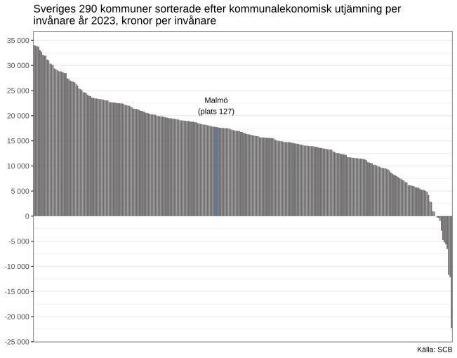
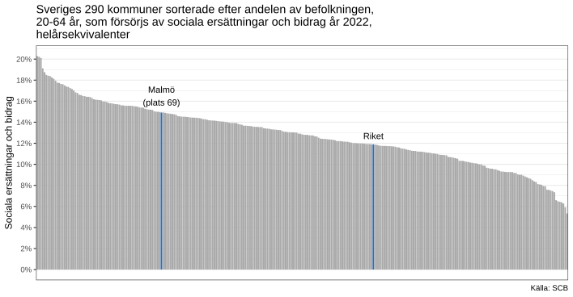
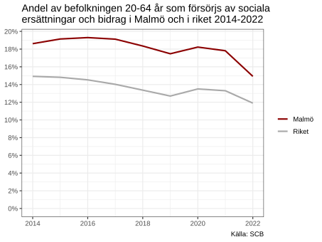

Ofta när man försöker bemöta villfarelser om statistik och har postat definitioner av sysselsättning och visat att Sverige faktiskt är ganska bra på att få in utrikesfödda så kommer ofta ett helt "off-topic" "men Malmö då?". Tydligen anses det vara ett dräpande argument att bara nämna Malmö.

Och visst har Malmö problem. Det är en segregerad stad som drabbades hårt av strukturomvandlingen på 70- och 80-talen. Dessutom kom omläggningen av kommualskattesystemet under 80-talet som innebar att kommunerna inte längre fick skatt från juridiska personer. Malmö hade dessutom hållit igen på villabyggandet och tappade därför ett stort antal invånare till villamattorna i kranskommunerna. 1970 hade Malmö som mest invånare innan vändningen på 90-talet. Då uppgick befolkningen till nästan 265 000 personer. 1984 hade befolkningen krymt till ca 229 000 invånare. Det skulle dröja till 2002 innan staden fick flera invånare än vad man hade 1970.

När sedan 90-talskrisen kom blev det riktigt illa. Staden räddades av driftiga kommunpolitiker som lyckades lobba till sig en högskola, Öresundsbron och en citytunnel. Dessutom kom en omläggning av skatteutjämningssystemet som räddade den kommunala ekonomin.

På senare år har EBO blivit ett problem. Många nyanlända flyktingar som inte kommit in på arbetsmarknaden har valt att bosätta sig i staden. Bostadsstrukturen i regionen är dessutom sådan att det är svårt att lämna Malmös bostadsmarknad när man är fattig och fått en bostad där. Kranskommunerna har brist på hyresbostäder och har i flera fall sålt ut sina allmännyttiga bostadsbolag. Det blir inte bättre av att vissa kranskommuner dessutom väljer att placera sin kvot av flyktingar i Malmö.

Men hur ser det ut i Malmö idag? Långt ifrån så illa som alternativhögern tror. Staden ligger på plats 127 när det gäller skatteutjämningsbidrag per invånare. Man ska dessutom komma ihåg att Malmö via skatteutjämningssystemet kompenseras för att ca 9 000 pendlare till Danmark inte betalar skatt i boendekommunen, utan i det land där de arbetar.

Av retoriken kring Malmö kan man ju tro att Malmö ligger i topp vad det gäller andelen invånare som lever på sociala ersättningar och bidrag. Men inte heller det stämmer. I Malmö försörjs knappt 33 000 invånare (omräknat till heltidsekvivaleter) av sociala ersättningar och bidrag, vilket motsvarar 14,9 % av stadens 219 000 invånare mellan 20-64 år. Motsvarande andel i riket är 11,9 %. Kanske inte så mycket att skryta med, men knappast någon katastrof heller.

Andra lite större kommuner som har en högre andel invånare än Malmö som lever på sociala ersättningar och bidrag är till exempel Helsingborg, Norrköping, Kristianstad, Trollhättan, Uddevalla och Norrköping.

Därmed inte sagt att staden saknar problem. Malmö tillhör kommunerna med högst arbetslöshet i landet. Samtidigt skapas många av regionens arbeten i staden och Malmö blir en allt viktigare arbetsmarknad för kranskommunerna. Kommuner som Vellinge, Burlöv och Svedala tjänar in runt hälften av kommunens samlade förvärvsinkomster i Malmö. Ett av stadens problem är att de jobb som skapas inte riktigt matchar kommunens egna invånares kompetenser.

De senaste årens kraftiga uppgång av andelen sysselsatta utrikesfödda har även kommit Malmö till del, vilket märks i den kraftiga nedgången av andelen försörjda av sociala ersättningar och bidrag:

**Källor:**

Kommunalekonomisk utjämning: <https://www.statistikdatabasen.scb.se/pxweb/sv/ssd/START__OE__OE0115__OE0115A/KomEkUtj/>

Sociala ersättningar och bidrag: <https://www.statistikdatabasen.scb.se/pxweb/sv/ssd/START__HE__HE0000/HE0000T01N/>
