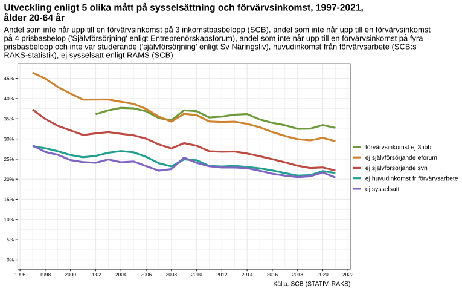
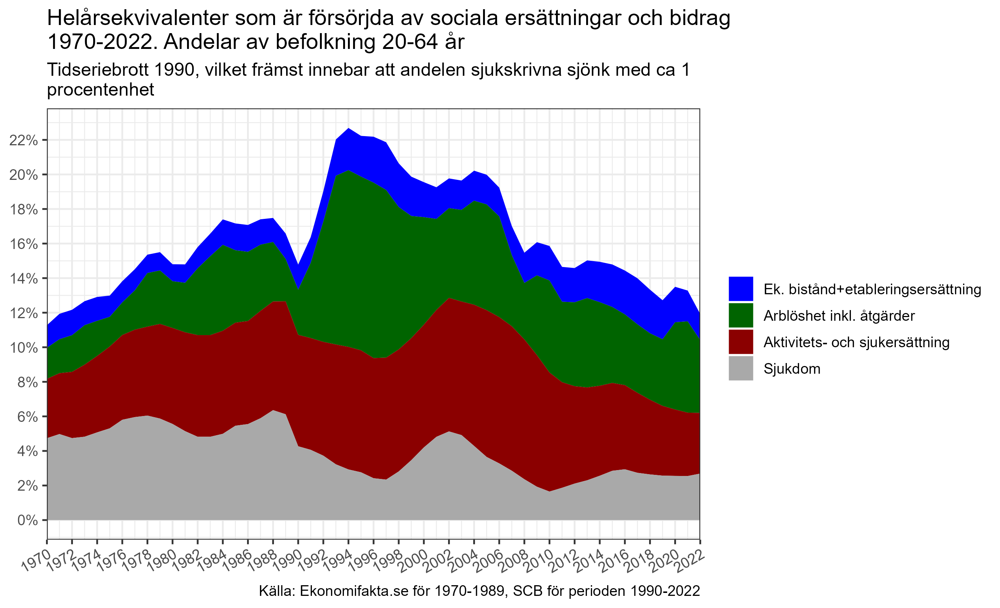

De senaste åren har det varit mycket diskussion om "självförsörjande" och sysselsättning. Entreprenörskapsforum fick en del uppmärksamhet för en [rapport](https://entreprenorskapsforum.se/wp-content/uploads/2021/11/Rapport_Sjalvforsorjning_REV-2021_Web.pdf) om "Självförsörjning" och det vimlar av självutnämnda experter på sociala medier som tror att de avslöjat någon stor dold sanning när de skriver att "det räcker att jobba en timme för att räknas som sysselsatt!" (det är en helt irrelevant invändning eftersom bara 0,15 % av de sysselsatta jobbar så lite, vilket jag skrivit om [här](https://lindellch.quarto.pub/statistik-och-strunt/posts/vad_ar_sysselsattning/)). Sedan har Svenskt Näringsliv hakat på och drivit [kampanj](https://www.svensktnaringsliv.se/utanforskap/) om att "i Sverige är bara 4 av 10 självförsörjande", tydligen i tron att i andra länder har man utbrett barnarbete och låter folk jobba tills de dör av hög ålder och inga i arbetsför ålder studerar eller är föräldralediga eller sjuka.

Men det finns två saker som man varit väldigt återhållsam med:

-   Man har nogsamt undvikit att publicera tidsserier över hur "självförsörjningsgraden" utvecklas.

-   Man har även nogsamt undvikit att visa vad de "ej självförsörjande" faktiskt har för inkomster (fastän alla de uppgifterna finns i SCB:s LISA-databas som angetts som källa).

Men hur ser det ut om man följer ett antal olika mått över "självförsörjning" och anknytning till arbetsmarknaden över tid? I samband med att jag höll en presentation för SCB tog jag fram diagrammet nedan. Diagrammet visar fem olika mått på arbetsinkomster och sysselsättning.

De fem måtten som jag tagit fram till diagrammet är följande:

-   Förvärvsinkomst under 3 inkomstbasbelopp, vilket är en gräns som används av SCB. (2021 motsvarade 3 inkomstbasbelopp 204 600 kr.).

-   Förvärvsinkomst under 4 prisbasbelopp, vilket är det mått som Entreprenörskapsforum använt för att definiera "ej självförsörjande". (2021 motsvarade 4 prisbasbelopp 190 400 kr.).

-   Förvärvsinkomst under 4 prisbelopp, exklusive studerande, vilket är det mått som Svenskt Näringsliv använt för att definiera "ej självförsörjande"

-   Ej sysselsatta enligt den registerbaserade RAMS-statistiken från SCB.

-   Personer som inte har sin huvudsakliga inkomst från förvärvsarbete. Data hämtade från SCB:s RAKS-register.

Alla mått är beräknade som andelar av befolkningen mellan 20-64 år.

{width="1060"}

Notera att oavsett vilket mått man väljer så är andelen som inte har arbete eller inte kommer upp i en inkomst som gör att att de räknas som "självförsörjande" sjunkande. Samtidigt förs debatten som om det aldrig varit eländigare än nu. Diagrammet slutar 2021. Sedan dess har utvecklingen på arbetsmarknaden varit stark, framför allt för utrikesfödda där det fortfarande finns en arbetskraftsreserv att ta av.

Som väntat sjunker Entreprörskapsforums och Svenskt Näringslivs "självförsörjningsmått" kraftigast. Det beror på att prisbasbeloppet följer kostnadsutvecklingen (KPI) och eftersom vi haft en relativt kraftig reallöneutveckling under perioden kommer en allt lägre andel av de sysselsatta tjäna mindre än 4 prisbasbelopp även vid en oförändrad sysselsättningsgrad. Detta används i Entreprenörskapsforums rapport som ett argument för att inte redovisa tidsserier. (Jag har dock svårt att begripa varför man valt ett mått kopplat till ett index om inte avsikten är just att redovisa tidsserier).

Men även andelen som inte kommer upp i en förvärvsinkomst på 3 *inkomstbasbelopp* sjunker. Till skillnad från prisbasbeloppet är inkomstbasbeloppet tänkt att följa inkomstutvecklingen och inte priserna. Trots det sjunker andelen som inte når upp till 3 inkomstbasbelopp.

Även andelen av befolkningen som saknar sysselsättning eller inte har sin huvudinkomst från förvärvsarbete sjunker, om än inte lika kraftigt som "självförsörjningsmåtten".

Oavsett vilket mått man väljer visar det på samma trend - en allt större andel av befolkningen i förvärvsarbetande ålder arbetar och har någorlunda rimliga inkomster.

Denna trend framgår även av SCB:s statistik över andelen invånare mellan 20-64 år, uttryckt som heltidsekvivalenter, som försörjs av sociala ersättningar och bidrag, vilket jag skrivit om [här](https://lindellch.quarto.pub/statistik-och-strunt/posts/bidrag/) . Sverige har den lägsta andelen av befolkningen som försörjs av sociala ersättningar och bidrag på nästan 50 år:

Men hur försörjer sig dem som inte når upp till Svenskt Näringslivs gräns för "självförsörjning"? Den frågan tänker jag återkomma till i ett kommande inlägg.
