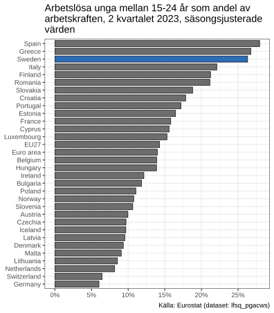
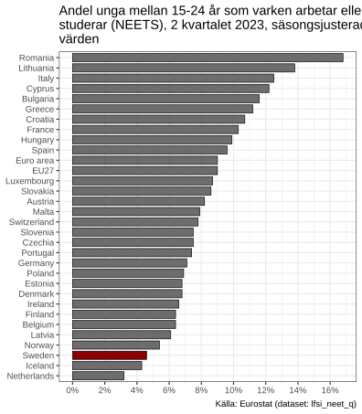

Ganska ofta ser man människor som skriver att "sysselsättning" är ett värdelöst mått och att vi borde mäta arbetslöshet istället". Se ett exempel nedan:

Jag har på andra ställen skrivit om att [sysselsättning](https://lindellch.quarto.pub/statistik-och-strunt/posts/vad_ar_sysselsattning/) är ett ganska välfungerande och internationellt standardiserat mått och om att [arbetslöshet](https://lindellch.quarto.pub/statistik-och-strunt/posts/arbetsloshet_ej_arbetande/) är ett betydligt mera svårtolkat mått än vad många tror, eftersom det inte räcker att sakna arbete för att vara arbetslös, man måste dessutom vara "aktivt arbetssökande".

Jämför man Sveriges ungdomsarbetslöshet (15-24 år) med övriga Europas så framgår att vi ligger på en föga hedrande tredjeplats efter Spanien och Grekland. Var femte ungdom är arbetslös! Eller..? Nej, det stämmer inte. Det är var femte ungdom av *arbetskraften* som är arbetslös. Endast de som antingen är arbetslösa eller förvärvsarbetande ingår i arbetskraften. Om vi räknar arbetslösa ungdomar som andel av befolkningen istället sjunker andelen arbetslösa till 17 procent. Men arbetslösheten är ännu mera svårtolkad än så. Av de drygt 200 000 arbetslösa ungdomarna är det 68 procent som är heltidsstuderande, vilket framgår av [SCB:s AKU-undersökning](https://www.statistikdatabasen.scb.se/pxweb/sv/ssd/START__AM__AM0401__AM0401L/NAKUArblheltidstudK/). Om vi bara räknar de arbetslösa som inte är heltidsstuderade sjunker andelen till drygt 5 procent av befolkningen. Den som påstår att arbetslöshet - till skillnad från sysselsättning - är ett enkelt och lätttolkat mått är helt enkelt ganska dåligt insatt i arbetsmarknadsstatistiken.

Ett skäl till att ungdomsarbetslösheten i Sverige är hög är att yrkesutbildning i Sverige sker inom ramen för gymnasieskolan, medan många andra länder som Tyskland, Österrike, Danmark och Norge m.fl. bedriver en stor del av yrkesutbildningarna på gymnasial nivå som lärlingsutbildningar där ungdomarna får en låg lärlingslön av arbetsgivarna. Det innebär två saker: Lärlingarna räknas som *sysselsatta* i statistiken, vilket i sin tur innebär att de inte kan vara arbetslösa även om de söker arbete eftersom man inte kan vara både sysselsatt och arbetslös samtidigt i arbetsmarknadsstatistiken. SCB har skrivit en intressant [rapport](https://www.scb.se/hitta-statistik/statistik-efter-amne/arbetsmarknad/arbetskraftsundersokningar/arbetskraftsundersokningarna-aku/pong/publikationer/bakgrundsfakta-ungdomsarbetsloshet--jamforbarhet-i-statistiken-mellan-ett-antal-europeiska-lander/) om detta.

Vi ligger alltså nästan högst i Europa vad gäller ungdomsarbetslöshet. Men det finns andra sätt att mäta ungdomars utanförskap. Ett sätt är att mäta NEET:s ("Not in Education , Employment or Training"), dvs unga som varken arbetar eller studerar. Även med detta mått hamnar Sverige på tredje plats, men denna gång från slutet! Vi har nästan den lägsta andelen unga i Europa som inte arbetar eller studerar, knappt 5 procent av de unga mellan 15-24 år. Det är bara drygt hälften så stor andel som i EU som helhet. Skälet till det är är bland annat att NEET:s mäts som andelen av befolkningen och inte av arbetskraften.

