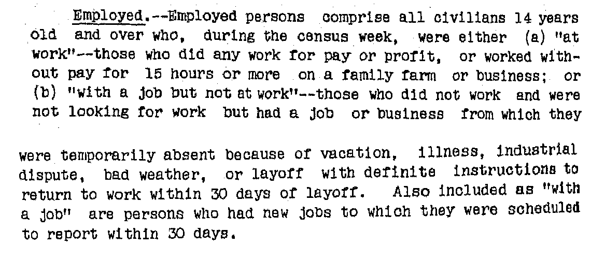

Den här bloggen är till stora delar irritationsdriven, vilket innebär att jag skriver om saker som irriterar mig. En av de saker som väcker min professionella missaktning är alla de som försöker politisera statistiska begrepp. Följer man debatten på sociala medier så verkar det som om "arbetslöshet" är höger och "sysselsättning" vänster. Det är helt befängt. Man behöver inte leta länge för att hitta den här typen av inlägg:

Det verkar som om folk tror att sysselsättning är påhittat av S för att manipulera folket. Men det är en falsk konspirationsteori av flera skäl. Dels är det inte regeringen som bestämmer hur arbetsmarknadsstatistiken ska mätas, det är FN-organet ILO som reglerar det. Det metodologiska finliret sköts av EU:s statistikorgan Eurostat.

Det är inte heller ett nytt mått.

Så här definieras sysselsättning av SCB:

> **Sysselsättningsgraden anger andelen sysselsatta personer av befolkningen i åldern 15--74 år**. En sysselsatt person är en person som under en viss vecka (referensveckan) utfört något arbete i minst en timme som anställd, egen företagare eller medhjälpare i företag tillhörande en familjemedlem.

Vi kan jämföra det med hur USA definierade sysselsättning år 1950 i det årets folkräkning (census):

Det finns väldigt stora likheter mellan definitionerna. Det räcker att arbete en väldigt kort tid under mätveckan för att räknas som sysselsatt (1 timme i Sverige, att man arbetat någonting överhuvudtaget i USA). Man räknar även oavlönat arbete i familjeföretag som sysselsättning. Sverige har en nedre tidsgräns på 1 timme, medan man i USA hade en gräns på minst 15 timmars arbete för att räknas som sysselsatt. I ILO-standarden anges att oavlönat arbete i familjeföretag måste varat i minst 1 timme för att räknas som sysselsättning.
