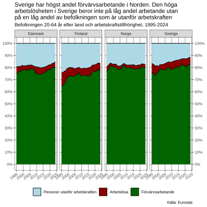
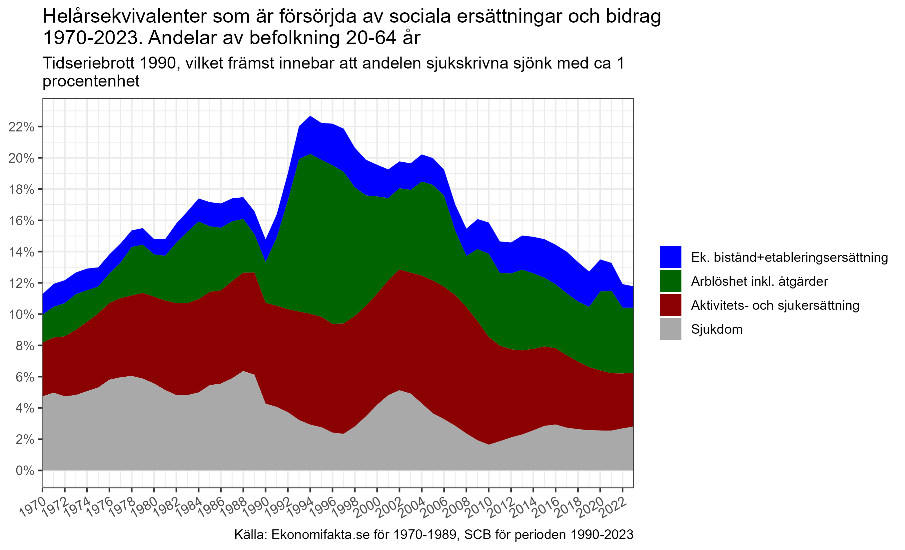

Ofta hör man att Danmarks och Norges arbetsmarknad fungerar mycket bättre än Sveriges eftersom Sverige har mycket högre arbetslöshet. Men då ställer jag mig frågan: Hur kan arbetsmarknaden sägas fungera bättre i våra grannländer när andelen förvärvsarbetande är LÄGRE än i Sverige?

Sverige har förvisso mycket högre arbetslöshet än Danmark och Norge, men många missar att vi också har en högre andel förvärvsarbetande.

För att förstå hur det kan gå till måste man reflektera över definitionerna på "arbetslöshet". Många tror att alla som inte arbetar är arbetslösa, men det är inte så statistiken funkar. För att räknas som arbetslös måste man uppfylla två kriterier:

1.  Man måste sakna arbete

2.  Man måste vara "aktivt arbetssökande"

Om man saknar arbete, men inte är "aktiv arbetssökande", är man inte arbetslös, utan hamnar i gruppen "utanför arbetskraften". Det som gör Sverige unikt är att vi har en väldigt låg andel som är "utanför kraften". Det är till stora delar ett resultat av "arbetslinjen" som i praktiken drivits av alla regeringar. Arbetslinjen bygger på att en så stor andel av befolkningen som möjligt ska ingå i arbetskraften, dvs antingen vara sysselsatta eller arbetssökande (arbetslösa). Ett resultat av detta är att andelen av befolkningen som försörjs av ersättningar kopplade till ohälsa har minskat kraftigt de senaste decennierna. Inte minst har andelen som har "förtidspension" (numera sjuk- och aktivitetsersättning) minskat kraftigt. Eftersom arbetslinjen bygger på att även grupper som har små chanser att få arbete, bland annat pga ohälsa, ska vara arbetssökande så är det paradoxalt nog så att "arbetslinjen" är svår att kombinera med låg arbetslöshet.

{width="632"}

Diagrammet nedan visar utvecklingen av hur stor andel av befolkningen som försörjs av sociala ersättningar och bidrag. I slutet av 80-talet var nästan 12 procent av befolkningen mellan 20-64 år försörjda av ersättningar kopplade till ohälsa. 2023 hade den andelen nästan halverats. Man kan ha olika åsikter om det är bra eller dåligt. Men jag tror inte att det är någon tvekan om att förändringen bidragit till att pressa upp arbetslösheten.

Min personliga åsikt? Jag tycker i grund och botten att det är bra att människor söker arbete och så många som möjligt kan arbeta och få en försörjning och bidra till vår gemensamma utveckling och välstånd. Men samtidigt får det inte gå så långt så att vi pressar sjuka människor med marginella chanser att få arbete att tvingas bli arbetssökande.
