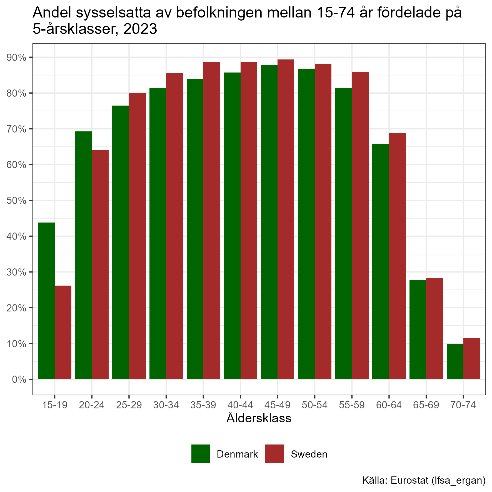

***Dansk arbetsmarknadspolitik beskrivs ofta som en succé jämfört med Sveriges, men stämmer det verkligen?***

Man hör ofta att Danmarks arbetsmarknad fungerar mycket bättre än Sveriges eftersom arbetslösheten är mycket lägre. Men om man istället tittar på arbetsmarknadens förmåga att skapa jobb åt befolkningen är Sveriges arbetsmarknad snarast bättre. Särskilt tydligt blir det om man tittar på åldersfördelad sysselsättningsgrad. Diagrammet nedan visar sysselsättningsgraden, dvs hur stor andel ålderskullen som är förvärvsarbetande, i Sverige och Danmark. Som synes är Sverige bättre på att sysselsätta sin befolkning i alla ålderskullar utom de två lägsta.

Vad är förklaringen till att så många unga danskar är sysselsatta? Det handlar till stor del om att vi valt olika system för att utbilda yrkesarbetare. I Danmark sköts grundläggande yrkesutbildning genom lärlingsutbildningar. De unga deltagarna får en låg lärlingslön vilket innebär att de räknas som "sysselsatta" i statistiken. I Sverige sker grundläggande yrkesutbildning via gymnasieskolan. Det innebär att man i statistiken räknas som "studerande" och inte är "sysselsatt" (såvida man inte arbetar vid sidan om studierna). Hade vi haft samma utbildningssystem hade Danmark kommit ut ännu ofördelaktigare jämfört med Sverige.

